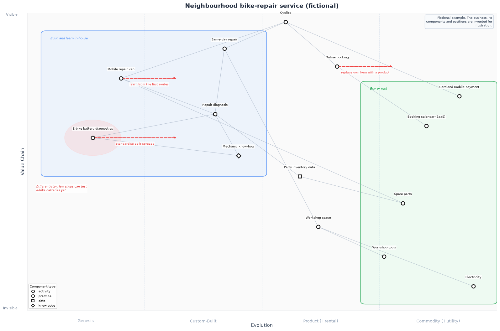

# Wardley Map Builder

Describe a Wardley map once in YAML, then render it as a PNG image (Python, matplotlib)
or draw it onto a Miro board (Node.js, optional).

*Built with Claude Code as co-developer.*



## Problem

Wardley maps tend to live in many places at once: slides, handouts, e-learning pages and
collaborative workshop boards. Drawn by hand, these copies drift apart, and moving a single
component means redrawing it everywhere. A map should be a small text file that can be
reviewed in a pull request and rendered the same way into every format.

## Approach

- **One YAML format** with normalised coordinates: evolution and value both run from 0 to 1.
  Components, dependencies, movements, groups, highlights, annotations and notes.
- **Strict validation first.** Unknown component ids, values outside 0..1, bad colours or a
  movement that would run off the map are reported together, with the place where they occur,
  before anything is drawn.
- **Two renderers, one format.**
  - `render_map.py` renders a PNG with matplotlib.
  - `miro/render-to-miro.js` draws a frame on a Miro board through the REST API v2, with
    request spacing, retries with backoff, and a `--dry-run` that writes the exact planned
    API calls to a JSON file instead of sending them.
- **Same notation in both outputs:** activity = circle, practice = hexagon, data = square,
  knowledge = diamond.

## Quick start

### PNG (Python 3.10+)

```bash
python3 -m venv .venv
.venv/bin/pip install -r requirements.txt

.venv/bin/python render_map.py maps --check                                   # validate all maps
.venv/bin/python render_map.py maps/bike-repair-service.yaml -o out/bike.png  # render one map
.venv/bin/python render_map.py maps/quiz-tea-stall.yaml --size small -o out/quiz.png
```

Exit codes: `0` all fine, `1` at least one invalid map, `2` usage error.

### Miro board (Node.js 20.12+, optional)

```bash
cd miro
npm install

# No account needed: writes ../out/bike.miro-plan.json with every planned API call
node render-to-miro.js ../maps/bike-repair-service.yaml --dry-run --plan ../out/bike.miro-plan.json

# Real run: copy ../.env.example to ../.env and set MIRO_ACCESS_TOKEN
node render-to-miro.js ../maps/bike-repair-service.yaml --new-board
node render-to-miro.js ../maps/bike-repair-service.yaml --board-id <board-id>
```

New boards keep Miro's default (private) sharing settings. Board names longer than 60
characters are shortened, because Miro rejects them.

### Tests

```bash
.venv/bin/python -m unittest discover -s tests -t .   # validation, rendering, CLI
cd miro && npm test                                     # validation, API client, renderer, CLI (offline)
```

The Node tests never touch the network: the API client takes an injected `fetch`, and the
renderer is tested against the dry-run client.

## YAML format

| Key | Required | Content |
|---|---|---|
| `title` | no | Map title |
| `components` | **yes** | `id`, `name`, `evolution` (0..1), `value` (0..1), `type` (`activity` default, `practice`, `data`, `knowledge`), optional `color`, `borderColor`, `labelOffset: {x, y}` in board pixels |
| `dependencies` | no | `from`, `to` (component ids), optional `color` |
| `movements` | no | `from` plus either `to` (component id) or `delta` (default 0.1, to the right); optional `label`, `color` |
| `groups` | no | `name`, `bounds: {evolution: [min, max], value: [min, max]}`, `color`, `borderColor` |
| `highlights` | no | `evolution`, `value`, `radius` (share of the map width, up to 0.5), `color` |
| `annotations` | no | `text`, `evolution`, `value`, `color` |
| `notes` | no | `text`, `position` (`top-right` default or `right`) |
| `axes` | no | `y: {label, top, bottom}`, `x: {label, stages}` with exactly four stages, each a name or `[name, subtitle]` |
| `layout` | no | Board size in pixels: `width`, `height`, `padding`, `componentSize`. Used on Miro and to scale `labelOffset` |
| `colors` | no | Overrides for the default palette |

Colours are hex values such as `#1a1a1a`. A complete example is
[`maps/bike-repair-service.yaml`](maps/bike-repair-service.yaml).

## Project layout

```
render_map.py              CLI for PNG output
wardley_map/model.py       YAML loading and validation
wardley_map/render.py      matplotlib renderer
tests/                     Python tests
maps/                      fictional example maps
miro/render-to-miro.js     CLI for Miro output
miro/src/                  validation, minimal Miro client, dry run, renderer
miro/test/                 Node tests (node:test)
.claude/skills/render-map  Claude Code skill for creating and rendering maps
```

## Working with Claude Code

`.claude/skills/render-map/SKILL.md` teaches Claude Code the workflow used here: write the
YAML, validate, render, look at the image, fix overlaps, and only then touch a real board
(after a dry run).

## How this was built

I defined the problem, the YAML format and the rendering rules; Claude Code drafted much of the implementation and the tests. For this public version, Claude Code consolidated several private working copies of the renderer into one tool and wrote new fictional example maps.

Three rules I follow when working with AI:

1. It only sees what I would also show a client.
2. It says what it has done.
3. Nothing leaves the house without human review.

## Credits

Wardley Mapping was created by Simon Wardley. His book *Wardley Maps* is published under
[CC BY-SA 4.0](https://creativecommons.org/licenses/by-sa/4.0/) at
<https://medium.com/wardleymaps>. The stage names and component types used here follow his
work. This repository contains code and fictional example maps only, no text from the book.

## Related tools

Small tools from my work as a trainer and facilitator:

- [learning-objective-lint](https://github.com/andreasschliep/learning-objective-lint): lint learning objectives against Bloom's taxonomy and check that an agenda practises them
- [miro-board-builder](https://github.com/andreasschliep/miro-board-builder): describe a Miro board in YAML, check it offline, then build it through the REST API
- [facilitation-planner](https://github.com/andreasschliep/facilitation-planner): plan a session backwards from acceptance sentences and let a checker keep the timing honest

More about me: [github.com/andreasschliep](https://github.com/andreasschliep)

## License

MIT, see [LICENSE](LICENSE).
